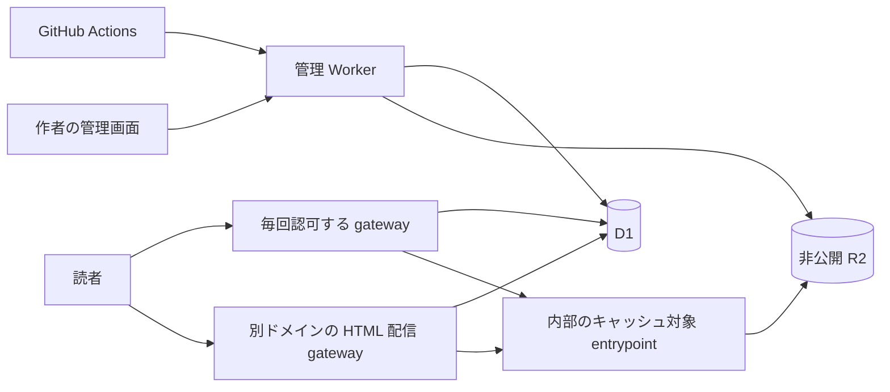

# 技術設計

利用者の行動、対象機能、実装順は [ストーリーマップ](../story-mapping.canvas)を参照する。以下は未実装の設計案。

<a id="architecture"></a>

## 構成とデータ

機能ごとに必要な構成とデータを、[ストーリーマップ](../story-mapping.canvas)に沿って段階的に実装する。

### 構成

既存の BarefootJS・Hono を管理画面と信頼する viewer に使う。共有 Workers、非公開 R2、D1 を基本構成とし、作者ごとに Worker を配備しない。



管理 Worker が本人確認、repository 連携、アップロード、公開設定、契約・販売設定を持つ。コンテンツ Worker が作者の HTML を別ドメインで配る。R2 は作者が作った静的ファイルを保存し、公開状態と閲覧権限は D1 のデータで判断する。サービス自身の CSS・JS・代替画像には Workers Static Assets を使う。ただし版の origin で作者の同名ファイルを隠さないよう Worker を先に動かすので、これらの request も Worker の課金対象になる。OGP 画像の不足時だけ、隔離したブラウザ撮影処理を呼ぶ。翻訳・音声・記事の生成 Worker と生成クレジットは置かない。

### 配信方式の比較

| 方式 | 判断 |
| --- | --- |
| 共有 R2 と Workers | 採用。作者間で公開を独立させ、下書き・有料資料を同じ認可で守れる |
| 資料ごとに Static Assets を配備 | 静的配信の課金面は魅力だが、Worker 群の配備・制限・復旧管理が増える。配信費が支配的になったら再検討 |
| 全資料を一つの Static Assets に含める | 一人の更新が全体の配備に影響するため採用しない |
| R2 を直接公開 | 公開済み画像の将来最適化候補。下書きや有料成果物の置き場は公開しない |

### データの責任

| データ | 保持する情報 |
| --- | --- |
| Account | 内部 ID、GitHub user ID、表示用 handle と旧名 |
| Workspace | 個人・チーム、所有者、契約、容量使用量 |
| Membership | Workspace、Account、役割、SSO 条件 |
| Deck | Workspace、slug、repository 連携、公開モード、読者区分、一般公開中 deployment、購入者向け現行 deployment、停止状態、revision |
| Deployment | Deck、commit SHA、inventory digest、不変 manifest、アップロード状態、作成順 |
| UploadSession | 有効期限、予約容量、受領済みファイル、冪等キー |
| ReleaseAccess | deployment の配信許可と過去版の扱い |
| ContentSession | 利用者、deployment、用途、期限、失効状態。下書きは作者用 |
| Subscription | 契約先 ID、plan、支払状態、適用期間、変更予約 |
| Listing | 販売対象の資料、価格、通貨、価格 revision、無料ページ番号、sample inventory、policy revision |
| Order | 購入者、確定価格・手数料、支払状態、Stripe の参照 ID |
| Entitlement | 購入者、対象資料、注文、閲覧権限の状態 |
| BillingEvent | Stripe account、test/live、event ID と処理状態 |
| DomainMapping | 所有確認済み hostname、workspace、deck、TLS 状態 |
| AnalyticsAggregate | deck、deployment、時間区間、event 種別、集計値 |

`UNIQUE(workspace_id, slug)` と workspace handle で URL を解決する。個人 workspace は作者の handle を使い `/@kfly8/good-slide` を維持する。チームの handle は別に予約する。handle は認可キーにしない。改名後の旧名を他人へ渡さない。

アップロード状態は `uploading -> validating -> ready`。失敗時は `failed` または `expired`。公開状態と読者区分は別に持つ。`ready` は誰でも読めることを意味しない。後続 scope のレコードを scope1 で先に実装する必要はない。

R2 の内部キーは `deployments/<id>/files/<path>`、追加成果物は `artifacts/<deployment>/<locale>/<page>/<digest>` などとする。公開 URL は内部キーを直結しない。

### 未確定

`slide.dev` と別のコンテンツドメインの所有・取得、wildcard DNS/TLS、Workers Cache と Wrangler の対応を実装時に確認する。名称・キー・API は提案であり、既存実装を表さない。

### 参照

[Workers Static Assets](https://developers.cloudflare.com/workers/static-assets/)、[R2 の公開方式](https://developers.cloudflare.com/r2/buckets/public-buckets/)。サービス仕様の調査日は 2026-11-05。変更されうる条件は導入時に再確認する。

<a id="deployment"></a>

## アップロードと公開の契約

対応する体験は [GitHub からスライドを更新する](../features/f01-github-deploy.md)、[下書きを確認して公開する](../features/f02-publication.md)、ページ単位の契約は、[発表画面の分離](../features/f04-presenter.md)、[ページ共有と OGP](../features/f05-page-ogp.md)、[多言語の説明](../features/f06-localization.md)、[音声での説明](../features/f07-narration.md)で使う。

### GitHub 連携

ブラウザの GitHub ログインは user ID を確定する。repository 登録時は管理権限を REST API で確かめ、repository ID、owner ID、許可 branch、必要なら protected environment を保存する。ソースへの書き込み権限は要求しない。GitHub App による選択 repository 管理と権限喪失通知は将来の選択肢。

Actions の OIDC をサービス自身で検証し、一つの upload session に限定した短命 credential へ交換する。署名・JWKS、issuer、専用 audience、期限、repository ID、owner ID、ref、event、設定された environment を照合する。production には pull request と `pull_request_target` を使わない。通常の `GITHUB_TOKEN` を当サービスの API token として受け入れない。JWKS の鍵更新、交換の再送・再利用、rate limit を扱う。repository 移転や権限喪失時は再確認まで新規アップロードを止める。

作者が CI または手元で任意の制作ツールを使い、完成した静的 directory だけを送る。公式 Action はアップロードだけを行い、Markdown の受信・ビルド、依存の導入、制作ツールの選択は行わない。以下の action は API の説明用で、配布済みではない。

```yaml
permissions:
  contents: read
  id-token: write
steps:
  - uses: actions/checkout@<full-commit-sha>
  - run: <install-and-build>
  - uses: slide-dev/deploy@<full-commit-sha>
    with:
      deck: good-slide
      path: dist
      manifest: slide.json
```

ビルド済み HTML なら build を省く。一つの repository に複数資料を置けるが、連携と出力先は資料ごとに明示する。fork の preview は production と別認可にする。

### 不変なアップロード

```text
beginUpload(principal, deck, inventory, idempotencyKey) -> UploadSession
putFile(session, path, digest, bytes) -> Receipt
finalizeUpload(session) -> ReadyDeployment | ValidationErrors
publish(principal, deck, deployment, expectedRevision) -> Publication | Conflict
unpublish(owner, deck, expectedRevision) -> PausedDraft | Conflict
resolveAccess(request) -> AuthorizedDelivery | NotFound
```

同じキー・inventory の再送は同じ session を返す。異なる inventory の再利用は失敗させる。ファイルのサイズと digest を受信中に確かめ、全件・入口・manifest・quota の検査後に `ready` にする。その後は上書きしない。巨大 archive を展開せず、inventory にあるファイルを並列数を制限して送る。

相対 path 以外、traversal、正規化後の重複、symlink、秘密ファイル、不正な media type、サーバー実行ファイルを拒否する。作者が指定した HTTP header は使わない。初期制限は本人利用を前提に小さく始める。[初期運用の設定案](#initial-limits)にまとめ、Cloudflare 自体の制限とは分ける。

### 公開の競合

公開は D1 の条件付き更新を確定点にする。revision、公開モード、停止状態、deployment の所有・ready を一度に検査し、公開 pointer と release access を更新する。先に R2 の全ファイルが揃うので、途中の状態は公開されない。古い CI の順序と開始時 revision を記録し、新しい公開を上書きしない。競合した版は下書きとして残す。作者が古い版を選ぶ操作は明示的な rollback。

管理画面モードは CI が下書きだけを作る。repository モードは manifest の `published` を反映し、`false` は既存の公開も止める。管理画面の停止は自動公開より優先し、revision を進める。再開とモード変更は明示操作。Git 上でファイルを消しても deck を削除しない。公開予約は保留。

初期案では版を置き換えると旧版の配信許可を外す。一般公開時は、その deployment の作者限定セッションを失効させ、一般公開の経路に切り替える。公開停止は匿名の旧版・画像・音声配信と既存の作者限定セッションを止める。所有者は再認証して作者限定で開ける。購入者向けには継続閲覧先の deployment を保持し、匿名公開 pointer の解除だけでは失効させない。発表中の旧版を壊しうるため置き換え前に警告し、発表中は次の版を下書きに保つ。読者向けの過去版選択や発表中の旧版維持は初期対象外。取得済みデータと外部 SNS の cache は回収できない。

### manifest とページ

任意 HTML は入口だけで配信できるが、ページ機能はページ番号で指定する。作者に固有 ID の設定を要求しない。以下は通常の公開資料向け例。有料資料の sample/full inventory は別の拡張契約とする。

```json
{
  "schemaVersion": 1,
  "title": "サンプル資料",
  "entry": "index.html",
  "language": "ja",
  "publication": { "published": false },
  "adapter": { "name": "reveal", "version": 1 },
  "pages": [{
    "number": 1,
    "title": "はじめに",
    "locator": { "h": 0, "v": 0 },
    "text": "このページの説明。",
    "previewImage": "previews/intro.png"
  }],
  "features": {
    "pageOgp": true,
    "translation": { "enabled": false, "locales": [] },
    "narration": { "enabled": false, "mode": "browser" }
  }
}
```

公開 section は repository モードだけで有効。features は翻訳・音声やブラウザ読み上げの利用を選ぶ。OGP の不足画像の撮影だけはサービス側のオンデマンド処理を許可する。locale と audio の参照形式は実装時に version 付き契約として確定し、inventory に含める。

adapter は `ready`、`getPage`、`goToPage`、`onPageChanged` と対応能力を宣言する。断片アニメーションとページ番号を区別する。共有 URL は `/p/3` のような1始まりの番号とする。新しい版で順序が変われば同じ番号の内容も変わってよい。存在しない番号は見つからないと返す。最初は Reveal.js 一種類。Marp・独自形式は契約検証後に追加。静的ページ記述だけでも OGP は提供できるが、同期操作の対応を偽らない。

### 参照

[GitHub OIDC](https://docs.github.com/en/actions/reference/security/oidc)。

<a id="access-control"></a>

## 配信とアクセス制御

対応する体験は [下書きを確認して公開する](../features/f02-publication.md)、[URL を渡して読んでもらう](../features/f03-sharing.md)、[無料ページで紹介して資料を販売する](../features/f12-paid-slides.md)、[社内のメンバーだけに共有する](../features/f13-team-sharing.md)、[会社のアカウントでログインする](../features/f14-sso.md)。

### URL と HTML の隔離

| URL 案 | 用途 |
| --- | --- |
| `slide.dev/@kfly8/good-slide` | 信頼する閲覧画面 |
| `.../p/1?lang=ja` | ページ単位の URL と metadata |
| `slide.dev/dashboard/...` | 作者の管理画面 |
| `d-<deployment>.slideusercontent.example/index.html` | 別ドメインでの作者 HTML |
| `d-<deployment>.slideusercontent.example/_preview/launch` | 作者のみ限定公開への認証入口 |

`slideusercontent.example` は所有予定を表す仮名。`slide.dev` の subdomain ではなく、別の登録可能ドメインを使う。版ごとに origin を変え、前の版が残すブラウザ状態の影響を分ける。各 origin の root から配るので相対・root 相対 asset が使える。directory index を明示し、未宣言の SPA fallback と外部 URL proxy は置かない。

サービスの認証 origin では作者の HTML・SVG・JS を実行しない。iframe は別 origin で `sandbox="allow-scripts allow-same-origin"` を使い、module の互換性を保つ。top navigation、popup、download、form は初期状態で許可しない。HTTP CSP の `worker-src 'none'` で直接アクセス時も service worker を防ぐ。外部依存は明示 policy と互換性試験で扱う。

認証 cookie は host-only、Secure、HttpOnly。CSRF と厳密な origin の CORS を適用する。iframe の `postMessage` は期待する origin、`event.source`、schema、view ごとの nonce を検査し、送信先は exact `targetOrigin` にする。子から公開操作、credential、任意 HTML 挿入を要求できない。

### 作者のみ限定公開

管理画面から所有者だけが一度限りの launch token を発行する。有効期限の提案は 60 秒。別 origin をトップレベル tab で開き、token を消費してそのホストだけの Secure・HttpOnly・SameSite=Lax session cookie を設定し、token のない入口へ redirect する。`/_preview/` は作者ファイルから予約する。

限定公開自体に 15 分などの短い利用期限は設けない。作者は一般公開まで確認と発表に使える。認証セッションには期限と更新を設け、全ファイルで作者本人・期限・失効を検査し、`private, no-store` で共有 cache を使わない。scope1 はトップレベルで raw deck を表示し、管理画面は元の tab に残す。発表機能を追加する段階で、作者限定のまま操作画面と観客画面を起動・再接続・更新できる認証動線を実装する。第三者 cookie に依存せず二画面が動くことを受け入れ条件とし、現在の raw 表示だけで満たしたことにしない。token と session は保存時に hash 化し、log から除く。`Referrer-Policy: no-referrer` と indexing 禁止を返す。下書きの画像・翻訳・音声は認証済み管理画面でも確認できるが、匿名 URL を作らない。

作者限定の cookie はその deployment の閲覧だけを許可し、管理 API の認証に使わない。再利用可能な第三者向け限定公開 link は初期範囲外。

### 公開・購入・所属の認可

公開状態と読者区分を分ける。下書きは作者以外へ配信しない。作者による一般公開・販売停止は匿名閲覧と新規購入を止めるが、既存購入者の継続閲覧先は残す。public、購入者限定、チーム限定はそれぞれ判断し、運営停止や権限の失効は cache を返す前に適用する。認可は wrapper だけでなく HTML、script、画像、字幕、翻訳、audio の各 URL に適用する。R2 は development endpoint を含め非公開に保つ。

購入者・チーム member の content session は内部 account ID と entitlement・所属・SSO の現在状態に結びつける。所属や権限が失効した session で cache を読めない。reader のログインから content session 開始まで、独自ドメインも含め第三者 cookie 不要の動線を実装時に確立する。

### 無料ページと完全版

全ページを一つの HTML・JS に含めた資料は、画面で隠すだけでは保護できない。作者側の出力を公開 sample と購入者向け full に分け、別 inventory・origin・内部 cache path を使う。sample から full の path を解決できない。

無料ページ番号 は deployment と policy revision に固定する。依存する font/style を両方に置くことはできるが、元 deck の依存物を自動で全部公開しない。HTML、JS、埋込データ、source map、画像、翻訳、音声に有料部分が残らないよう作者が匿名の実物を確認する。inventory 検証は任意 script の意味的な秘密を証明できない。

対応 exporter が sample を作るか、作者が別途用意する。navigation adapter だけではページ分離を保証できない。sample がないときは部分無料を有効化せず、販売説明ページだけを公開する。無料設定の縮小では旧 sample URL も認可で止める。cache に policy revision を含め、deploy と設定を原子的に切り替える。

目次は作者が公開を許したタイトルと locked 表示に限る。有料ページの OGP は公開用説明と汎用画像を使い、明示された teaser 画像以外は本文や画像を漏らさない。TEAM の資料に無料ページ設定があっても匿名公開へ変えない。販売停止後の継続閲覧は [決済設計](#buyer-access-after-unpublish)に従う。

### 発表者ノートと外部録画

秘密のノートは HTML、コメント、source map、公開 manifest に入れない。初期は presenter の端末だけに置く。翻訳・読み上げの自動入力にもしない。

動画連携の字幕・記事にも同じ認可を適用する。独立して公開済みの YouTube 動画は、資料の購入制限によって非公開にはならない。

### 参照

[iframe](https://developer.mozilla.org/en-US/docs/Web/HTML/Reference/Elements/iframe)、[postMessage](https://developer.mozilla.org/en-US/docs/Web/API/Window/postMessage)。

<a id="billing"></a>

## Stripe と契約・販売

対応は [利用に合ったプランを契約する](../features/f08-subscriptions.md)、[無料ページで紹介して資料を販売する](../features/f12-paid-slides.md)。PRO・TEAM の内容は [ストーリーマップ](../story-mapping.canvas)を参照する。

### 決定と未決

販売と販売手数料には Stripe Connect を使う。PRO・TEAM の subscription に Stripe Billing を使うことは候補で、確定ではない。価格、通貨、手数料率、課金周期、TEAM の席数課金、支払失敗の猶予、返金条件は未決。販売に PRO を必須にしないことは初期提案。

workspace が契約を持つ。server が plan と支払状態から機能・容量の権限を導く。manifest や client の設定では上位権限を与えない。Stripe 固有の状態変換は billing module に閉じる。

### 契約の更新と縮小

customer/subscription ID、plan、適用期間、次回変更を保存する。checkout からの戻りだけで支払済みにしない。検証済み event を durable に保存してから反映し、順不同・重複・欠落は provider の現在状態と照合する。解約は期間末まで利用可とする案だが、正式条件は提供前に決める。

縮小でファイルを消さず、新 quota を超える追加 upload を止める。独自ドメインの解除と分析保持は条件を明示する。TEAM 終了で社内資料を公開しない。資料購入の entitlement は作者の契約とは独立する。

### 販売価格と注文

資料全体の価格を通貨の最小単位の整数で保持する。通貨別制限は Stripe 導入時に検証する。無料ページは任意のページ番号の集合。ゼロ件でも販売説明ページから売れる。新しい版への更新時には無料になるページの実物と番号を必ず再確認する。追加ページは初期状態で有料扱い。

order は price revision、価格、通貨、fee rule、作者取り分、購入対象の資料と購入時点の決済条件を snapshot として持つ。購入権限は資料に結びつけ、資料更新後も使える。見積もり期限内は固定するか、変更後の価格への再同意を求める。無断で金額を変えない。購入後の価格変更で過去の購入を変えない。資料が更新された場合は編集後の内容を提供し、過去版を選ぶ機能は初期対象外であることを購入前に示す。

### Connect の構成案

seller workspace を connected account に結び、Stripe-hosted onboarding で登録する。checkout 有効化前に必要 capability を確かめる。一注文一作者を前提に、Checkout と destination charge、`application_fee_amount` を使う案。導入時に対象地域と settlement の責任を確認する。

価格、通貨、送金先、手数料は server が listing と snapshot から決め、client が送る値では決めない。Checkout Session、PaymentIntent、connected account、transfer、application fee の ID を保存する。checkout 作成に注文単位の冪等キーを使う。

この構成案では Stripe の処理費は platform 残高から差し引かれるので、販売手数料は純利益ではない。connected account への transfer と銀行への payout を区別する。返金では seller transfer の reversal と application fee の refund を明示的に照合する。返金だけで全資金移動が自動で戻ると考えない。

### 支払と閲覧権限

webhook は raw body と署名で検証する。event の識別には Stripe account、test/live、event ID を含める。重複処理でも order と entitlement を一度だけ作る。遅延決済も含め成功確認後に閲覧可能にする。test/live の鍵・接続先・注文・webhook secret を混ぜない。

返金・dispute では契約した条件に従い order と entitlement を変える。payout 失敗で購入者の完了済み注文を消さない。公開停止は配信を止めても注文記録を残す。作者が販売・一般公開を停止した場合や退会した場合も、既存購入者は継続して読める。返金・運営停止・サービス終了の条件は別途定める。取得済み HTML のコピーを防ぐ商品ではなく、アクセス権を販売する。

### タテブログとの接点

[piconic-ai/tate](https://github.com/piconic-ai/tate) は同系統の Workers・Hono・BarefootJS・D1 構成。確認した製品文書では記事無料・本の販売・作者還元は検討段階であり、slide の販売方針で上書きしない。

ユーザー申告の前提として、タテブログへの適用には、はてな・KADOKAWA の許可が必要。まず slide で動線を作り、許可後の別作業にする。今回 tate の実装・文書は変更しない。

commerce は product namespace、material ID、edition を参照し、slide の URL 規則を埋め込まない。作者登録・注文・手数料・event・返金・entitlement は共通化候補。商品ごとの renderer が権限を適用する。購入が他サービスの資料まで許可しないよう namespace を分ける。

まず slide 内の module とし、二つ目の許可済み実装で共通契約が分かってから切り出す。共有 Stripe account、利用者 ID、subscription、サービス横断購入は前提にしない。

### 参照

[Stripe marketplace](https://docs.stripe.com/connect/marketplace)、[destination charges](https://docs.stripe.com/connect/destination-charges.md?platform=web&ui=stripe-hosted)、[webhook](https://docs.stripe.com/webhooks)。

<a id="operations"></a>

## キャッシュ・費用・運用・検証

### キャッシュの位置

Workers Cache は hit 時に対象 Worker の実行を省けるが、request 課金は残る。R2 のファイルを Worker で返しても Static Assets の無料配信にはならない。

公開停止・購入・所属を反映するため、gateway は毎回 primary と整合する D1 の状態で認可し、その後に内部の cached entrypoint を呼ぶ。実行と権限 lookup の費用は残す。下書きは共有 cache を使わない。将来、公開資料の認可を cache するなら失効遅延を別仕様として明示し、黙って弱めない。

Workers Cache の default key は host を含まない。別 deployment の同じ `/index.html` が混ざらないよう、検証済み origin を内部の deployment・bundle 区分付き path へ変換してから cache を引く。wrapper、作者 HTML、無料 sample、full の key と header policy を分ける。内部 entrypoint を直接外部公開しない。

| 応答 | 方針 |
| --- | --- |
| login、管理 API、preview | private, no-store |
| 公開 wrapper | 認可後、deployment・page・locale・policy revision で内部 cache |
| 作者ファイルと画像・audio | 認可後に不変な内部 bytes を cache、browser は再検証 |
| サービス自身の CSS・JS | version 付き Static Assets |
| 不足する OGP 画像 | 初回だけ撮影・R2 保存。生成中・失敗時は代替画像 |

長期の内部 TTL を browser にそのまま転送しない。作者の公開停止後は匿名の旧 URL からの取得も止め、既存購入者向けの現行版は維持する。認可済みで実行中の request は完了しうる。認可状態は cache だけで判断しない。tag は運用清掃に使い、失効を purge 成功だけに依存させない。古い Cache API は Worker 内で動く別方式。Wrangler schema と実環境の対応を導入時に確認する。

### 費用の考え方

閲覧回数 `V`、browser cache 後の追加ファイル request 数 `A` として、配信 request は概ね `R = V × (1 + A)`。gateway は毎回動く。内部 hit 率 `H` なら origin read はおおむね `R × (1 - H)` に manifest と upload を足す。購入・所属には追加の indexed lookup がある。内部呼び出しの課金は実測で確かめる。

仮に月 10 万閲覧、各 10 asset request なら約 110 万配信 request。これは予測・測定結果ではない。2026-11-05 の確認では Workers Standard は月 $5 から、R2 Standard は $0.015/GB-month、Class A は $4.50/百万回、Class B は $0.36/百万回、Internet egress は無料。無料枠や超過課金があり、これだけで総額とはしない。

D1 rows、保存した過去版・音声・画像、独自ドメイン、分析、決済、監視、abuse traffic も費用になる。CI と翻訳・音声・記事生成は作者負担。OGP 撮影はサービス負担で、生成回数とブラウザ時間を計測する。quota 予約、保持版数、upload rate limit、bounded retry で制御する。request、CPU、cache hit、R2 operations、D1 rows、analysis writes、保存 bytes を分けて計測する。

### 機能固有の実装

OGP はページ URL の HTML に server で metadata を含める。fragment だけではページを識別できない。作者の raster 画像を優先し、不足画像は公開を許可されたページだけを初回に撮影・保存する。SVG を認証 origin で返さない。翻訳・audio は version 付き参照で受け取る。原文 fallback と不足機能の非表示を用意する。

presenter は信頼する同一 origin の window 間で BroadcastChannel を使う。deck・deployment・ランダム session ごとに分け、再接続時に snapshot を送る。観客 wrapper が adapter に操作を渡す。複数発表の混線、focus、fullscreen、popup block を browser で確認する。遠隔同期 server は初期不要。

analytics は信頼する viewer の open/page-change を計測し、rate limit と非同期集計を使う。cache の file hit を人の閲覧と数えない。保持期間・閲覧者の privacy・plan 縮小時の扱いを公開前に決める。分析失敗は閲覧を止めない。

### 復旧と保持

不足する任意翻訳・audio は原文や通常閲覧へ戻す。宣言されたファイル自体が不正・欠落なら upload 検証で失敗させる。作者が直して新しい deployment を送る。

支払 event は acknowledgement 前に durable 保存し、未完了を再処理・照合する。期限切れ upload の予約容量を解放する。staging と未参照版の GC 猶予は 7 日を提案。削除前に公開、作者限定セッション、rollback、購入者の継続閲覧先を再検査する。作者が確認・発表に使っている版は期限切れ staging として削除しない。prefix だけで削除許可を判断しない。D1 backup と R2 manifest からの復旧を試す。

所有者削除、通報、管理者停止を用意する。運用 log は workspace・deck・deployment・request・billing event ID を中心にし、preview token、credential、本文、秘密ノートを記録しない。

### 実装時に確かめること

- scope1 の縦断動作で upload サイズ、公開時間、一閲覧あたり request、gateway CPU、D1 rows、cold/warm R2 read を記録する。
- 二つの origin の `/index.html` が cache で混ざらず、下書き ID から取得できないことを確認する。
- 作者限定の失効と公開停止が全 asset に効き、古い CI が停止後に公開しないことを確認する。
- 同じ価格での重複購入処理、遅延決済、event の重複・順不同、返金・送金照合を Stripe test で確認する。
- 未購入者が sample から full を取得できず、JS・source map・翻訳にも有料内容がないことを実物で確認する。
- 無料ページの番号と新版への差し替え、locale 不足、adapter 不足、member 削除、SSO 失効、TEAM 終了を試す。
- 公開資料と次の下書きの bytes が混ざらず、秘密ノートが公開物にないことを確認する。

文書整合性は `python3 scripts/check-docs.py` で確認する。これは実装の動作検証とは別。Cloudflare の cache・billing は本番相当環境で観察し、local emulation だけで保証しない。

### 参照

[Workers Cache](https://developers.cloudflare.com/workers/cache/)、[cache keys](https://developers.cloudflare.com/workers/cache/cache-keys/)、[configuration](https://developers.cloudflare.com/workers/cache/configuration/)、[limitations](https://developers.cloudflare.com/workers/cache/limitations/)、[Workers pricing](https://developers.cloudflare.com/workers/platform/pricing/)、[R2 pricing](https://developers.cloudflare.com/r2/pricing/)、[D1 pricing](https://developers.cloudflare.com/d1/platform/pricing/)、[BroadcastChannel](https://developer.mozilla.org/en-US/docs/Web/API/Broadcast_Channel_API)。

<a id="talk-reading"></a>

## 動画・音声と文字起こしの契約案

[登壇内容を読みながら動画と資料をたどる](../features/f15-talk-reading.md) の探索用。recording は ID、参照元、言語、長さを持つ。transcript segment は安定 ID、開始・終了時刻、話者、本文を持つ。slide cue は recording の時刻と特定 deployment のページ番号を結ぶ。編集記事は原文と別にし、段落から元の segment ID へ戻れるようにする。作者の訂正は新しい版で受け取る。

初期実験は WebVTT、対応表、Markdown 記事。再生追従とページから録画への移動は任意対応で、再生できなくても文章と資料を読めるようにする。YouTube URL は参照・埋め込み用であり、任意動画の取得や音声抽出をサービスに追加する意味ではない。文字起こし・話者分離・章分け・編集・対応付けは作者側で行う。

[LISTEN](https://listen.style/guide) と [ログミー](https://logmi.jp/) は体験の参考。公開・有料・TEAM の権限を字幕・記事・章・画像・録画 asset にも適用し、無料 sample や検索用データへ本文を漏らさない。

<a id="initial-limits"></a>

## 本人利用から始める初期上限

初期のアップロードは運営者本人の GitHub account ID だけを許可する。公開資料の読者にログインを要求する意味ではない。利用者を増やすときに許可設定を変える。

以下は小さく試すための設定案で、確定したプラン料金や Cloudflare の上限ではない。運用設定で変更できるようにし、公開資料を消さず必要に応じて引き上げる。各 feature に値を複製しない。

| 設定 | 初期提案 |
| --- | --- |
| 一 deployment の合計 | 10 MiB |
| 一ファイル | 5 MiB |
| 一 deployment のファイル数 | 100 |
| 一作者の保存合計 | 50 MiB |
| 一作者のアップロード開始回数 | 1日5回 |
| 同時アップロード | 1件 |
| 一作者の deck 数 | 20 |

成功した現行版と使用中の作者限定版は保持する。不要な過去版の整理は作者が確認してから行う。クライアント表示とサーバーの検証は同じ設定を使い、上限変更後の次のアップロードから適用する。サーバーは `wrangler.jsonc` の `UPLOAD_LIMITS` で既定値を上書きする。uploader の事前検査はまだ既定値を使い、サーバーの設定とは連動していない。

<a id="buyer-access-after-unpublish"></a>

## Zenn を参考にした公開停止後の購入者アクセス

2026-11-05 に [Zenn 利用規約 第8条](https://zenn.dev/terms)を確認した。作者が公開を停止した場合や退会した場合も、購入者は購入済みコンテンツを継続して閲覧できる。更新後は編集後の内容が閲覧対象になる。運営によるサービス停止や規約上の措置などの制約は別にある。

ユーザーの指定により、slide も新規販売・匿名公開の停止と既存購入者の閲覧を分ける。作者が停止・退会しても、購入権限と購入者向けの資料を保持する。一般公開中の deployment とは別に、購入者が読む現行 deployment を参照できるようにし、更新時にはその参照を切り替える。購入者には編集後の内容を提供し、購入時の旧版を選ぶ機能は作らない。

作者の停止操作や通常の GC は、購入者が読む現行ファイルを削除しない。返金や運営による停止、サービス終了に関する例外は、通常の販売停止と区別して条件化する。

<a id="ogp-rendering"></a>

## OGP 画像のオンデマンド撮影

作者の提供画像を最優先し、ないときだけ必要になったページを撮影する。キーは deployment、ページ番号、locale、sample/full 区分、policy revision、描画設定版を含める。R2 に保存し、Workers Cache だけの eviction で再撮影しない。画像 URL に任意の撮影先 URL を渡せる API は作らない。

画像 request の認可後、保存済みなら即返す。未生成なら D1 の一意キーと期限付き実行権で同時生成をまとめる。初回は短い待機時間内での撮影を試し、間に合わなければ代替画像を返して durable なジョブとして継続する。取りこぼし・重複実行・失敗時の再試行に対応し、完了後に描画結果を R2 へ保存する。初回に返した代替画像が SNS に保存される場合があるため、共有前に作者が画像を準備・確認できる導線も置く。

Browser Run などの実行先は実装時に選ぶ。撮影環境には管理用 secret を渡さず、作者ごとに browser context を分ける。private network、任意の外部 navigation、無制限の通信・実行時間・同時実行を制限する。撮影中も公開状態を再検査し、非公開・有料の本文を匿名 OGP にしない。有料ページは明示された teaser または汎用画像のみ。作者限定画面の撮影は初期対象外。

初期案は SNS 向け 1200 × 630 px の PNG/JPEG。縦横比が異なるスライドは余白を付け、内容を切り落とさない。サイズはサービスの提案であり、すべての SNS に同じ表示を保証する仕様ではない。X の大きいカード用 metadata と実際の共有結果を確認する。

オンデマンド化は全ページ一括撮影より未利用ページの処理を減らすが、安くなることを保証しない。月間生成数、各回の browser 実行時間、再試行、R2 operations を測る。[Browser Run 料金](https://developers.cloudflare.com/browser-run/pricing/)は実行方式に応じて browser 時間と同時実行数を課金する。

SNS に保存済みのカード画像は当サービスから直接消せない。画像を更新しても再取得されるまで古い見た目が残りうる。公開停止は以後の当サービスへの取得を止めるもので、他社が保存済みの画像の削除を保証しない。
