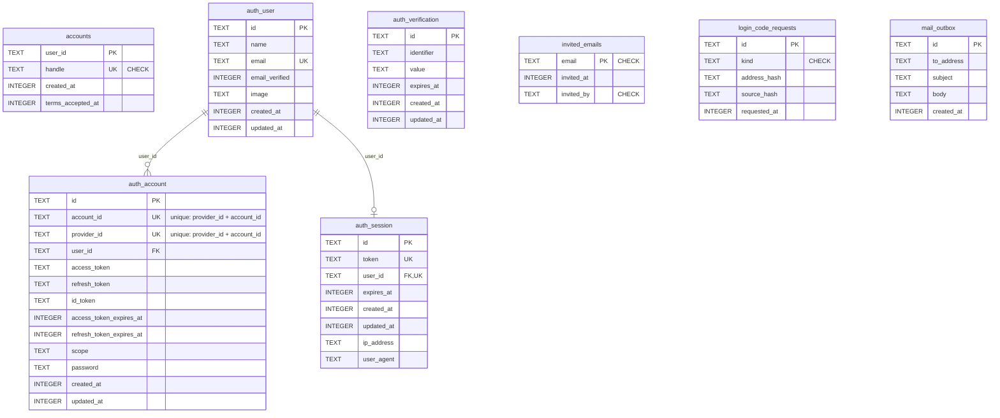
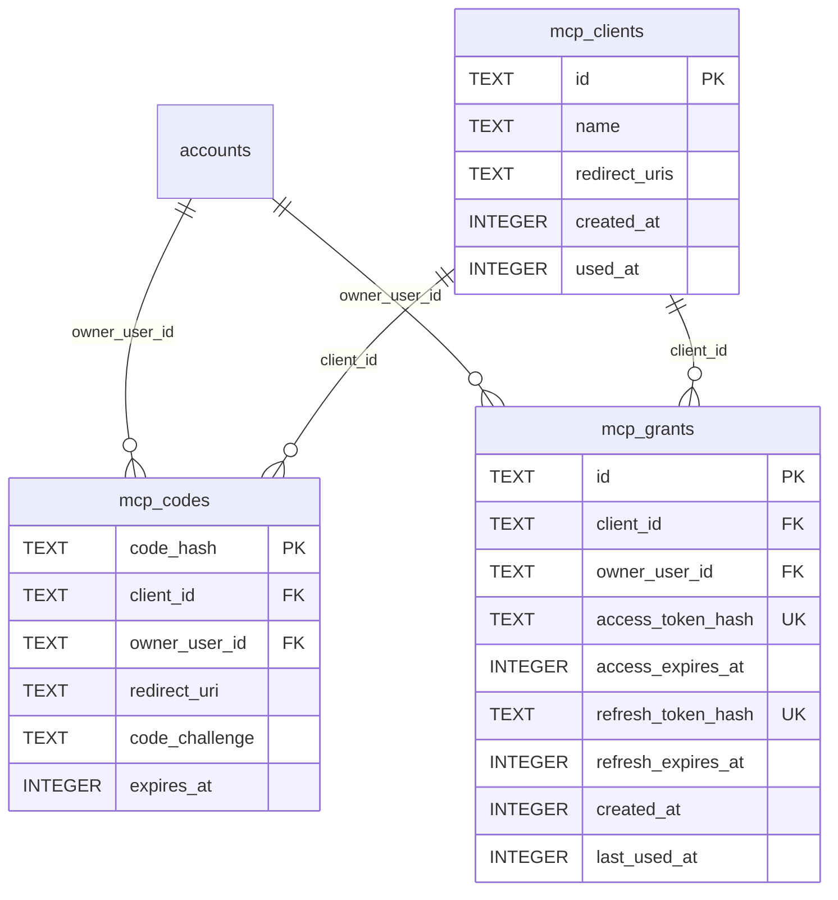
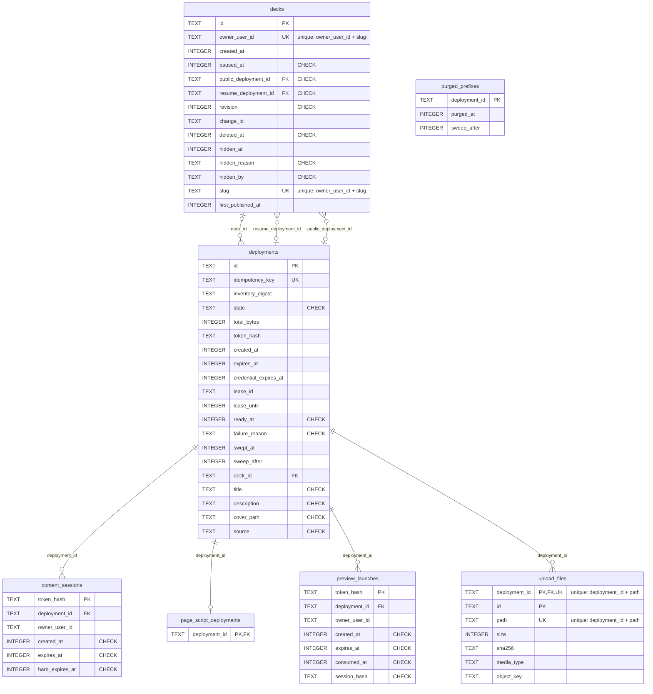
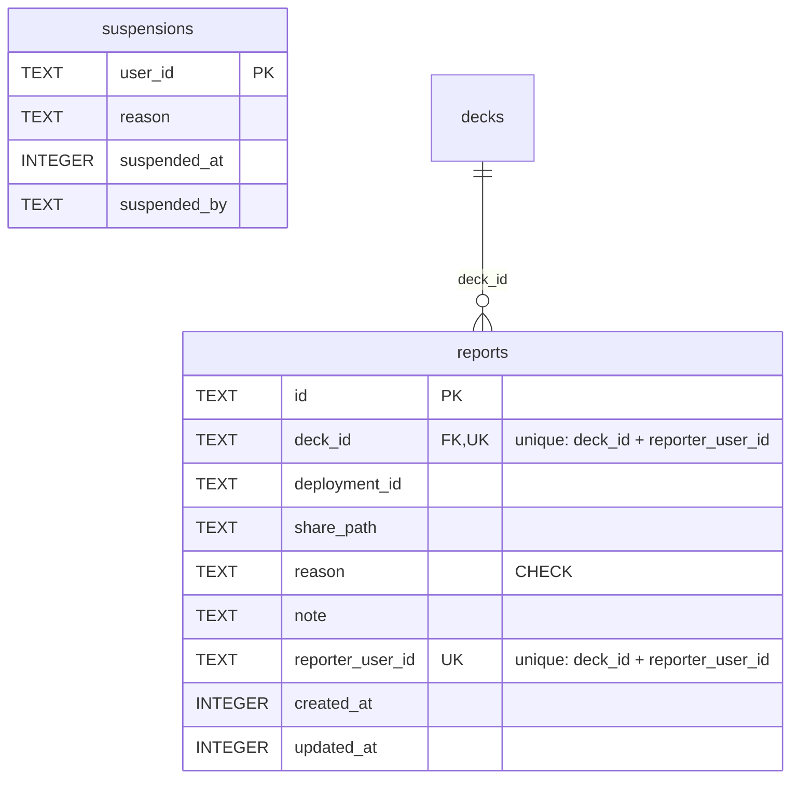
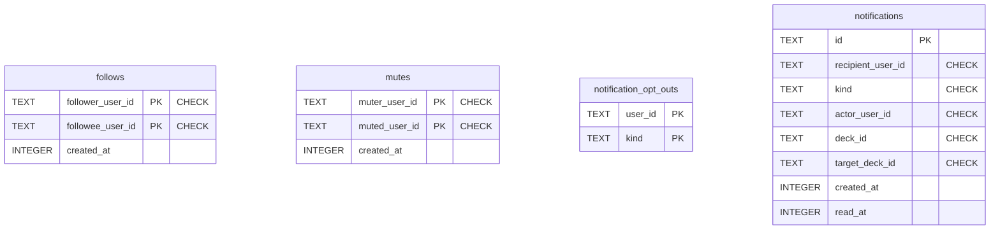
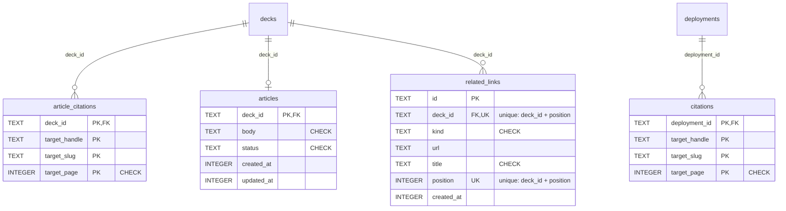
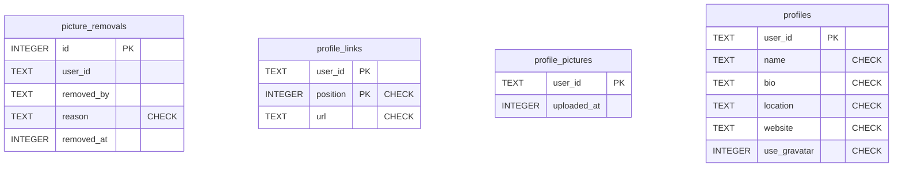

# データベースの ER 図

生成物。手で編集しない。`pnpm db:er` で生成し直す。

`migrations/` を空の SQLite に順に適用した結果から作る。本番の D1 に適用されるものが正本で、`src/db/schema.ts` は読まない。外部キーを宣言している参照だけを線で結ぶ。宣言のない参照(たとえば `owner_user_id`)は、列として図に出るだけで、線にはならない。

## 読み方

- 列の `PK` は主キー、`FK` は外部キー、`UK` は UNIQUE。複数の列で一意になるものは、備考に `unique: a + b` と出る。`CHECK` は、その列を CHECK 制約が参照している。
- 線の `||` は必ず 1、`|o` は 0 または 1(参照する列が NULL を許す)、`o{` は 0 以上、`o|` は 0 または 1(参照する列が一意)。線の名前は、参照する列。
- 別の図の表を参照するときは、その表を列なしで描く。部分的な UNIQUE(`WHERE` つきの索引)は一意として数えない。

## 全体の関係

全ての表と、宣言した外部キーだけ。列は各ドメインの図にある。

```mermaid
erDiagram
    accounts
    article_citations
    articles
    auth_account
    auth_session
    auth_user
    auth_verification
    citations
    content_sessions
    decks
    deployments
    follows
    invited_emails
    login_code_requests
    mail_outbox
    mcp_clients
    mcp_codes
    mcp_grants
    mutes
    notification_opt_outs
    notifications
    page_script_deployments
    picture_removals
    preview_launches
    profile_links
    profile_pictures
    profiles
    purged_prefixes
    related_links
    reports
    suspensions
    upload_files
    decks ||--o{ article_citations : "deck_id"
    decks ||--o| articles : "deck_id"
    auth_user ||--o{ auth_account : "user_id"
    auth_user ||--o| auth_session : "user_id"
    deployments ||--o{ citations : "deployment_id"
    deployments ||--o{ content_sessions : "deployment_id"
    deployments |o--o{ decks : "resume_deployment_id"
    deployments |o--o{ decks : "public_deployment_id"
    decks |o--o{ deployments : "deck_id"
    accounts ||--o{ mcp_codes : "owner_user_id"
    mcp_clients ||--o{ mcp_codes : "client_id"
    accounts ||--o{ mcp_grants : "owner_user_id"
    mcp_clients ||--o{ mcp_grants : "client_id"
    deployments ||--o| page_script_deployments : "deployment_id"
    deployments ||--o{ preview_launches : "deployment_id"
    decks ||--o{ related_links : "deck_id"
    decks ||--o{ reports : "deck_id"
    deployments ||--o{ upload_files : "deployment_id"
```

## 認証と利用者

メールのコードでのログイン、Better Auth の利用者とセッション、招待、作者のアカウント。

表: `accounts`、`auth_user`、`auth_account`、`auth_session`、`auth_verification`、`invited_emails`、`login_code_requests`、`mail_outbox`

## AI エージェントの接続

MCP の OAuth クライアント、認可コード、許可の記録。

表: `mcp_clients`、`mcp_codes`、`mcp_grants`

## スライドと版

スライド(decks)、置かれた版(deployments)、受け取り中のセッションとファイル、プレビュー。

表: `decks`、`deployments`、`content_sessions`、`upload_files`、`page_script_deployments`、`preview_launches`、`purged_prefixes`

## 通報と運営

通報と、アカウントの停止。

表: `reports`、`suspensions`

## フォローとお知らせ

フォロー、ミュート、お知らせと、その受け取りの設定。

表: `follows`、`mutes`、`notifications`、`notification_opt_outs`

## 記事と関連リンクと引用

スライドに付く実況記事、関連リンク、スライドと記事からの引用。

表: `articles`、`article_citations`、`related_links`、`citations`

## プロフィール

プロフィール、リンク、顔写真と、その取り下げ。

表: `profiles`、`profile_links`、`profile_pictures`、`picture_removals`

